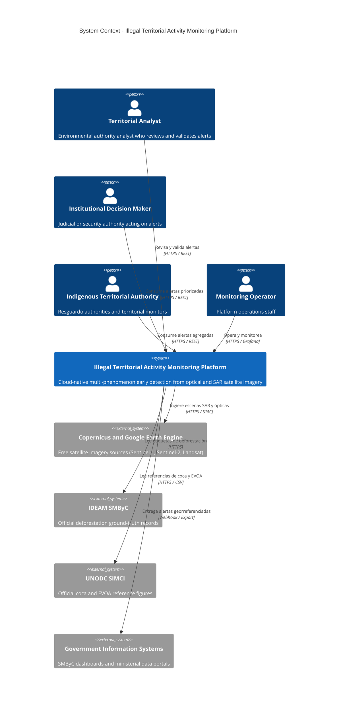
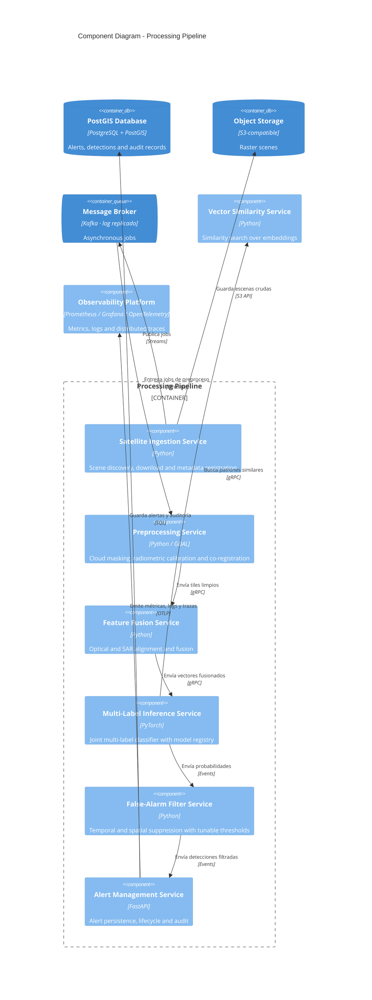

# Early Detection of Illegal Territorial Activities via Satellite Imagery: A Cloud-Based Multi-Phenomenon Monitoring Architecture

**Deliverable 2 — Executive Review II: Enterprise Architecture & System Implementation**

| Field | Value |
|---|---|
| **Course** | Enterprise Architecture and Digital Transformation |
| **Authors** | Juan Pablo Vélez Muñoz · Luiza Mariana Gonzalez Veloza · Daniel Alexander Ahumada León |
| **Date** | September 2026 |
| **Document version** | 1.0 |
| **Companion model** | `enterprise-architecture-archimate.xml` (ArchiMate 3.1) |
| **Grounded on** | Deliverable 1 (`main.tex`) — problem, state of the art, gap, proposed solution |

---

## Table of Contents

1. [Resumen Ejecutivo y Alcance](#1-resumen-ejecutivo-y-alcance)
2. [Dominios de Arquitectura Empresarial (ArchiMate 3.1)](#2-dominios-de-arquitectura-empresarial-archimate-31)
   - [2.1 Business Architecture](#21-business-architecture)
   - [2.2 Data Architecture](#22-data-architecture)
   - [2.3 Application Architecture](#23-application-architecture)
   - [2.4 Technology & Infrastructure Architecture](#24-technology--infrastructure-architecture)
   - [2.5 Integration & Security Architecture](#25-integration--security-architecture)
   - [2.6 Observability & Operations Architecture](#26-observability--operations-architecture)
3. [Especificaciones Técnicas y Evidencia de Implementación](#3-especificaciones-técnicas-y-evidencia-de-implementación)
   - [3.1 C4 Model](#31-c4-model)
   - [3.2 API Specification](#32-api-specification)
   - [3.3 Deployment & Cloud Evidence](#33-deployment--cloud-evidence)
4. [Atributos de Calidad y Análisis de Trade-offs](#4-atributos-de-calidad-y-análisis-de-trade-offs)
5. [Modelo Financiero y Gobernanza](#5-modelo-financiero-y-gobernanza)
   - [Supuestos y Limitaciones](#supuestos-y-limitaciones)

---

## 1. Resumen Ejecutivo y Alcance

### 1.1 Resumen Ejecutivo

La capacidad de negocio que implementa esta arquitectura es el **monitoreo territorial multi-fenómeno de actividades ilícitas con detección temprana** (*multi-phenomenon territorial monitoring with early detection*). No se trata de un producto analítico aislado ni de un ejercicio académico de visión por computador: se trata de una capacidad institucional que permite a una autoridad ambiental o judicial pasar de un ciclo de supervisión trimestral o anual a un ciclo operativo de alerta temprana, con evidencia georreferenciada y trazable sobre tres fenómenos que hoy se monitorean por separado.

El Deliverable 1 documentó que la deforestación en Colombia pasó de 79.256 ha (2023) a 113.608 ha (2024, +43%) y a 119.483 ha (2025, +5,2%); que los cultivos de coca crecieron de 204.000 ha (2021) a 253.000 ha (2023); y que la explotación de oro de aluvión (EVOA) pasó de 57.984 ha (2021) a 63.123 ha (2022, +8%), con un 73% de esa extracción calificada como ilícita en 2022. También documentó que los tres fenómenos coocurren: el 44% de los territorios con extracción aluvial también presentaban cultivos de coca, y en esas zonas de solapamiento la actividad ilícita alcanzó el 87%. La conclusión operativa de esa evidencia es que las tres actividades comparten factores impulsores y geografía, pero el Estado las vigila con tres tuberías desconectadas, cada una con latencias de meses o años.

Esta arquitectura responde a ese vacío con cinco decisiones de diseño heredadas y formalizadas desde el Deliverable 1: (1) fusión multi-fuente óptica + SAR; (2) clasificación conjunta multi-etiqueta; (3) gestión explícita de falsas alarmas con umbrales configurables; (4) entrega de alertas georreferenciadas mediante una API REST estructurada; y (5) escalabilidad cloud-native. El aporte de este entregable es convertir esas decisiones en una arquitectura empresarial completa —negocio, datos, aplicaciones, tecnología, integración/seguridad y observabilidad— expresada en ArchiMate 3.1 y verificable mediante diagramas C4, un contrato OpenAPI 3.0.3 y artefactos de despliegue.

El alcance de inversión se mantiene deliberadamente acotado al piloto definido en el Deliverable 1: la región de Caquetá / Putumayo, con umbrales de *go/no-go* de recall ≥ 0,75 en al menos dos de los tres fenómenos, precision ≥ 0,70 en los tres y tasa de falsos positivos ≤ 0,20 sobre el espacio combinado de etiquetas. La arquitectura se diseña para escalar de ese piloto a cobertura nacional sin un incremento proporcional en costo operativo ni en intervención manual, pero **este documento describe el diseño, no resultados de despliegue**: los indicadores de calidad del modelo permanecen como hipótesis a validar por el piloto.

### 1.2 Matriz de Alineación Estratégica

La siguiente matriz conecta cada requisito de negocio con la decisión de diseño que lo atiende y con la sección y artefacto donde se materializa. Es el hilo de trazabilidad que permite a un evaluador verificar de extremo a extremo que la arquitectura no es decorativa.

| ID | Requisito de negocio | Decisión de diseño | Realización en la arquitectura | Sección / Artefacto |
|---|---|---|---|---|
| **BR-01** | Detectar conjuntamente los tres fenómenos (deforestación, minería ilegal, coca) | Clasificación multi-etiqueta compartida en lugar de tres clasificadores binarios aislados | Proceso *Joint Multi-Label Classification*; componente *Multi-Label Inference Service*; capacidad *Multi-Phenomenon Detection* | §2.1, §2.3, §3.1 (C4 L2/L3), XML `BP04`, `AC04`, `BCP01` |
| **BR-02** | Mantener observabilidad durante nubosidad persistente | Fusión multi-fuente óptica (Sentinel-2, Landsat) + SAR (Sentinel-1) | Proceso *Multi-Source Feature Fusion*; componente *Feature Fusion Service* | §2.2, §2.3, §3.1 (C4 L2), XML `BP03`, `AC03` |
| **BR-03** | Reducir falsas alarmas para preservar la confianza institucional | Filtro post-clasificación con consistencia temporal, contexto espacial y umbrales configurables | Proceso *False-Alarm Filtering*; componente *False-Alarm Filter Service*; capacidad *Early Alert Management* | §2.1, §2.3, §4.1, XML `BP05`, `AC05`, `BCP03` |
| **BR-04** | Entregar alertas estructuradas y georreferenciadas, no imágenes para inspección manual | API REST con contrato OpenAPI 3.0.3 | Interfaz *Alert Delivery REST API*; componente *Alert API Gateway* | §2.3, §3.2, XML `AI01`, `AC07` |
| **BR-05** | Escalar del piloto a cobertura nacional sin costo proporcional | Microservicios contenedorizados sobre Kubernetes con autoescalado | Nodos *Kubernetes Cluster*, *GPU Inference Node*; software *Kubernetes*, *Docker* | §2.4, §3.3, §5.1, XML `TN01`–`TN02`, `TS01` |
| **BR-06** | Acortar la latencia entre cambio territorial y alerta accionable | Ingesta automatizada programada + colas asíncronas de inferencia | Procesos *Satellite Data Acquisition*, *Preprocessing and Calibration*; software *Message Broker* | §2.1, §2.3, XML `BP01`–`BP02`, `SS06` |
| **BR-07** | Atribuir causa del cambio de cobertura y no solo detectarlo | Etiquetas multi-fenómeno más registro de auditoría por alerta | Capacidad *Territorial Intelligence and Traceability*; objeto *Alert Audit Record* | §2.1, §2.2, XML `BCP04`, `DO08` |
| **BR-08** | Proteger datos sensibles de territorios indígenas y *resguardos* | Clasificación de sensibilidad, minimización y control de acceso por rol | Dominio de seguridad Zero Trust; objeto geográfico con anonimización | §2.2, §2.5, XML `DO06`, `BA03` |
| **BR-09** | Integrarse con SMBYC, UNODC/SIMCI y portales de datos del Estado | Entregas desacopladas (webhook/export) además de la API síncrona | Interfaz *Institutional Integration Interface*; capacidad *Institutional Integration* | §2.3, §2.5, XML `AI03`, `BCP05` |
| **BR-10** | Viabilidad económica sostenible para una entidad pública | Arquitectura serverless donde es posible, almacenamiento por capas y autoescalado a cero | Modelo FinOps base vs. producción; software *Object Storage* y *Autoscaling* | §3.3, §5.1, XML `TS02`, `TN03` |

### 1.3 Alcance de este Entregable

**Dentro de alcance.** Arquitectura empresarial de los seis dominios en ArchiMate 3.1, modelo C4 de tres niveles, contrato de API, artefactos de despliegue, evaluación de atributos de calidad, análisis de alternativas rechazadas, estimación de costos y gobernanza/riesgos.

**Fuera de alcance.** Implementación de código de producción, entrenamiento de modelos, obtención de datasets reales, resultados experimentales (que corresponden a las secciones 6–7 del Deliverable 1) y negociación de convenios interinstitucionales. Toda cifra de costo o de desempeño que no provenga del Deliverable 1 se rotula explícitamente como **estimación** o **supuesto** y se consolida en la sección *Supuestos y Limitaciones*.

**Trazabilidad.** Los elementos nombrados en este documento (por ejemplo *Multi-Label Inference Service*, *False-Alarm Filter Service*, *Alert Delivery REST API*) aparecen con el mismo nombre en el modelo ArchiMate `enterprise-architecture-archimate.xml`, de modo que el texto y el modelo formal pueden auditarse de forma cruzada.

---

## 2. Dominios de Arquitectura Empresarial (ArchiMate 3.1)

### 2.1 Business Architecture

El dominio de negocio describe **quién** usa la capacidad, **qué** se hace y **qué valor** se produce. La arquitectura no introduce procesos institucionales nuevos: digitaliza y acelera procesos de vigilancia territorial que hoy existen con latencia trimestral o anual.

#### Elementos y relaciones (ArchiMate)

| ID | Tipo ArchiMate | Nombre | Rol en la arquitectura |
|---|---|---|---|
| `BA01` | BusinessActor | Environmental and Territorial Authority | IDEAM y autoridades ambientales regionales; consumidor primario y dueño del monitoreo de deforestación |
| `BA02` | BusinessActor | Judicial and Security Authority | Fiscalía, Fuerza Pública; consumidor de alertas con valor probatorio |
| `BA03` | BusinessActor | Indigenous Territorial Authority | Autoridades y *resguardos* afectados; veedores del territorio y sujetos de protección de datos |
| `BA04` | BusinessActor | International Monitoring Organization | UNODC / SIMCI; aporta cifras de referencia y valida metodología |
| `BR01` | BusinessRole | Territorial Analyst | Interpreta y valida alertas; ajusta umbrales de sensibilidad |
| `BR02` | BusinessRole | Monitoring Operator | Opera la plataforma, supervisa la ingesta y la salud del pipeline |
| `BR03` | BusinessRole | Institutional Decision Maker | Decide operativos o intervenciones a partir de las alertas |
| `BCP01` | BusinessCapability | Multi-Phenomenon Detection | Detección conjunta de los tres fenómenos sobre el mismo territorio |
| `BCP02` | BusinessCapability | Cloud-Cover Resilient Monitoring | Observabilidad sostenida pese a nubosidad tropical persistente |
| `BCP03` | BusinessCapability | Early Alert Management | Conversión de detección en alerta gestionada, validada y priorizada |
| `BCP04` | BusinessCapability | Territorial Intelligence and Traceability | Atribución de causa y trazabilidad auditable de cada alerta |
| `BCP05` | BusinessCapability | Institutional Integration | Reutilización de alertas por los sistemas del Estado |
| `BP01` | BusinessProcess | Satellite Data Acquisition | Ingesta programada de escenas Sentinel-1/2 y Landsat |
| `BP02` | BusinessProcess | Preprocessing and Calibration | Enmascarado de nubes, calibración radiométrica y corregistro |
| `BP03` | BusinessProcess | Multi-Source Feature Fusion | Alineación y combinación de las firmas óptica y SAR |
| `BP04` | BusinessProcess | Joint Multi-Label Classification | Clasificación simultánea de los tres fenómenos |
| `BP05` | BusinessProcess | False-Alarm Filtering | Supresión de alertas espuria por consistencia temporal y contexto |
| `BP06` | BusinessProcess | Alert Publication and Delivery | Materialización y entrega de la alerta georreferenciada |

#### Relaciones

| Fuente | Tipo | Destino | Justificación |
|---|---|---|---|
| `BR01` | Assignment | `BA01` | El analista territorial ejerce su rol para la autoridad ambiental |
| `BR02` | Assignment | `BA01` | El operador de monitoreo pertenece a la operación institucional |
| `BR03` | Assignment | `BA02` | El decisor institucional actúa en el ámbito judicial/seguridad |
| `BR01` | Assignment | `BP05` | El analista ejecuta la validación del filtro de falsas alarmas |
| `BR02` | Assignment | `BP01` | El operador es responsable de la adquisición de datos |
| `BP01` | Flow | `BP02` | La escena cruda alimenta el preprocesamiento |
| `BP02` | Flow | `BP03` | El *tile* preprocesado alimenta la fusión |
| `BP03` | Flow | `BP04` | El vector fusionado alimenta la clasificación |
| `BP04` | Flow | `BP05` | La probabilidad multi-etiqueta alimenta el filtro |
| `BP05` | Flow | `BP06` | La alerta filtrada se publica y entrega |
| `BP01` | Realization | `BCP02` | La ingesta multi-sensor realiza la robustez ante nubosidad |
| `BP03` | Realization | `BCP02` | La fusión óptica+SAR realiza la robustez ante nubosidad |
| `BP04` | Realization | `BCP01` | La clasificación conjunta realiza la detección multi-fenómeno |
| `BP05` | Realization | `BCP03` | El filtrado realiza la gestión de alerta temprana |
| `BP06` | Realization | `BCP05` | La entrega realiza la integración institucional |
| `BP06` | Realization | `BCP04` | La publicación con auditoría realiza la trazabilidad |

#### Justificación

**Valor generado.** El valor de negocio no es "un modelo de IA" sino un cambio de latencia y de cobertura. Hoy el *SMBYC/ATD* entrega alertas de deforestación con cadencia trimestral y sin atribución de causa; *SIMCI* publica coca anualmente; *EVOA* corre en un ciclo similar. La arquitectura reduce esa latencia a un ciclo operativo de días y, sobre todo, entrega las tres lecturas en un mismo expediente territorial. Eso habilita decisiones que hoy son imposibles: priorizar un operativo donde la minería ilícita coincide con coca (el 44% de los territorios aluviales, con 87% de ilicitud en solapamiento), en lugar de descubrir el solapamiento meses después.

**Procesos versus capacidades.** Los seis procesos se modelan como una cadena de valor con un flujo lineal y cuatro puntos de control humano (validación del analista). La decisión de mantener un humano en el lazo no es una limitación técnica: el Deliverable 1 establece que la confianza institucional depende de la especificidad, y una alerta con implicaciones judiciales requiere responsabilidad identificable. El rol *Territorial Analyst* es, por diseño, el responsable de aceptar o rechazar una alerta antes de que se convierta en acción.

**Sensibilidad territorial como restricción de negocio.** El actor `BA03` (autoridades indígenas) no es un mero consumidor: es un sujeto de protección. La arquitectura trata la ubicación de actividades ilícitas en territorios colectivos como dato sensible (ver §2.2 y §2.5), lo que se traduce en reglas de minimización y de acceso por rol. Este es un requisito de negocio de primer orden, no una consideración de cumplimiento añadida al final.

**Alineación con TOGAF.** El dominio de negocio se documenta siguiendo el patrón *Business Architecture* de TOGAF ADM (fase B): capacidades, roles, actores y procesos, con trazabilidad explícita hacia requisitos. Las capacidades `BCP01`–`BCP05` funcionan como el vocabulario estable contra el cual se justifican las decisiones de las capas técnicas subyacentes.

### 2.2 Data Architecture

El dominio de datos responde a una pregunta concreta: **cómo se transforma una escena satelital cruda en una alerta georreferenciada auditables y consultables**. La arquitectura combina tres motores de persistencia especializados —almacenamiento de objetos para ráster, base relacional con extensión geoespacial para entidades y metadatos, y una base vectorial para búsqueda por similitud— porque forzar todo a un solo motor degradaría tanto el costo como la capacidad analítica.

#### Elementos y relaciones (ArchiMate)

| ID | Tipo ArchiMate | Nombre | Descripción |
|---|---|---|---|
| `DO01` | DataObject | Sentinel-1 SAR Scene | Escena radar de banda C; fuente clave para penetrar nubosidad |
| `DO02` | DataObject | Sentinel-2 Optical Scene | Escena multiespectral (resolución de trabajo de 10–20 m, parámetro de diseño); base de las firmas espectrales |
| `DO03` | DataObject | Landsat Scene | Escena óptica complementaria para la serie histórica |
| `DO04` | DataObject | Preprocessed Raster Tile | Ráster enmascarado, calibrado y corregistrado |
| `DO05` | DataObject | Fused Feature Vector | Representación multi-fuente alineada por celda territorial |
| `DO06` | DataObject | Georeferenced Alert | Entidad de alerta con geometría, etiquetas y confianza |
| `DO07` | DataObject | Ground-Truth Label | Etiqueta oficial IDEAM / UNODC usada para entrenamiento y evaluación |
| `DO08` | DataObject | Alert Audit Record | Bitácora inmutable de quién validó o descartó una alerta |
| `DO09` | DataObject | Embedding Index | Índice vectorial para búsqueda por similitud de patrones territoriales |

#### Relaciones

| Fuente | Tipo | Destino | Justificación |
|---|---|---|---|
| `DO05` | Composition | `DO01` | El vector fusionado compone la escena SAR como componente |
| `DO05` | Composition | `DO02` | El vector fusionado compone la escena óptica como componente |
| `DO05` | Composition | `DO03` | El vector fusionado compone la escena Landsat como componente histórica |
| `DO01` | Flow | `DO04` | La escena SAR fluye al preprocesamiento |
| `DO02` | Flow | `DO04` | La escena óptica fluye al preprocesamiento |
| `DO03` | Flow | `DO04` | Landsat fluye al preprocesamiento |
| `DO04` | Flow | `DO05` | El ráster preprocesado se vectoriza y fusiona |
| `DO05` | Flow | `DO06` | El vector fusionado produce la alerta |
| `DO07` | Access | `DO05` | Las etiquetas oficiales etiquetan el vector de entrenamiento |
| `DO06` | Composition | `DO08` | La alerta compone su propio registro de auditoría |
| `DO06` | Flow | `DO09` | La alerta se indexa como embedding para similitud |
| `DO08` | Access | `DO06` | La auditoría referencia de forma inmutable la alerta |

#### 2.2.1 Modelo Conceptual

El modelo conceptual organiza el territorio en una jerarquía que evita mezclar entidades físicas con entidades de negocio:

```
TerritoryUnit (departamento / municipio / resguardo)
   └── Observation (fecha, sensor, cobertura nubosa)
          └── Detection (fenómeno, confianza, geometría)
                 └── Alert (estado, severidad, etiquetas múltiples)
                        └── AuditRecord (actor, acción, timestamp)
```

`Detection` es la lectura cruda del modelo; `Alert` es la entidad de negocio sujeta a flujo de validación. Esta separación es deliberada: permite reprocesar detecciones sin destruir el historial de alertas ya entregadas a una institución.

#### 2.2.2 Modelo Lógico (persistencia relacional / PostGIS)

La persistencia transaccional se implementa en PostgreSQL con la extensión PostGIS. Las entidades principales son:

| Tabla | Clave | Columnas relevantes | Propósito |
|---|---|---|---|
| `territory_unit` | `id` (UUID) | `name`, `level`, `geom` (MULTIPOLYGON), `sensitivity` | Unidades territoriales y su clasificación de sensibilidad |
| `scene` | `id` (UUID) | `sensor`, `acquired_at`, `cloud_cover`, `object_uri` | Metadatos de cada escena ingerida |
| `detection` | `id` (UUID) | `scene_id`, `phenomenon`, `confidence`, `geom` (GEOMETRY) | Lecturas por fenómeno antes de convertirse en alerta |
| `alert` | `id` (UUID) | `territory_id`, `severity`, `status`, `labels` (JSONB), `geom` | Alerta multi-etiqueta lista para consumo |
| `alert_label` | `alert_id`, `phenomenon` | `confidence` | Descomposición multi-etiqueta explícita |
| `audit_record` | `id` (UUID) | `alert_id`, `actor_id`, `action`, `created_at` | Bitácora append-only |
| `label_source` | `id` | `provider`, `year`, `object_uri` | Procedencia de etiquetas oficiales |
| `threshold_config` | `id` | `phenomenon`, `precision_target`, `updated_by` | Umbrales configurables por operador |

Se usan índices espaciales GiST sobre `geom` para consultas por *bounding box* y por proximidad, y un índice GIN sobre `labels` para consultas por combinación de fenómenos.

#### 2.2.3 Persistencia Complementaria

**Object storage.** Los ráster crudos y preprocesados (escenas SAR/ópticas, *tiles*) se almacenan como objetos inmutables con *lifecycle policies* por capas: acceso frecuente durante el ciclo de inferencia, luego transición a almacenamiento de menor costo. Se referencian por URI (`object_uri`) desde la capa relacional, nunca se embeben en la base.

**Vector database.** En el piloto, la búsqueda por similitud se resuelve con la extensión `pgvector` dentro de la misma base PostgreSQL (imagen que incluye PostGIS y `pgvector`), sin un servicio dedicado. En producción, cuando el volumen lo exige, el índice migra a un motor vectorial dedicado. Almacena embeddings de la firma espacio-temporal de cada detección y habilita dos casos de uso: (a) recuperar territorios históricamente análogos a una alerta nueva, y (b) detectar patrones recurrentes que un clasificador por celda no captura.

#### 2.2.4 Linaje de Datos

El linaje es estricto y unidireccional, con identificadores persistentes:

```
Sentinel/Landsat (Copernicus / Google Earth Engine) 
   → DO01/DO02/DO03  [escena cruda + metadatos]
   → DO04            [enmascarado, calibración radiométrica, corregistro]
   → DO05            [fusión óptica+SAR, ventana temporal]
   → DO06            [inferencia multi-etiqueta + filtro de falsas alarmas]
   → DO09            [indexación vectorial]
   → DO08            [registro de auditoría al validar/descartar]
```

Cada transformación registra la versión del modelo y la versión del código que la produjo, de modo que una alerta entregada a la Fiscalía puede reconstruirse y explicarse. Este requisito es lo que habilita el uso como evidencia y responde directamente a `BCP04` (*Territorial Intelligence and Traceability*).

#### 2.2.5 Gobernanza, Retención y Sensibilidad

**Propiedad.** IDEAM (o la entidad adoptante) es *data owner*; el equipo de plataforma actúa como *data steward*. UNODC/SIMCI conserva la propiedad de las etiquetas aportadas.

**Clasificación de sensibilidad.** Se definen tres niveles: `public` (estadísticas agregadas y series abiertas), `restricted` (alertas con geometría a nivel de predio) y `sensitive` (alertas que intersectan territorios indígenas, datos de personas o información con valor probatorio activo). El nivel `sensitive` exige minimización en el origen: la geometría se publica de forma agregada o con retardo temporal, y el acceso se restringe por rol.

**Retención.** Escenas crudas: según política de la fuente (típicamente 12 meses en almacenamiento cálido, luego archivado). Detecciones y alertas: retención mínima de 10 años por valor histórico y probatorio. Índices vectoriales: reconstruibles, retención operativa de 24 meses. Registros de auditoría: retención mínima de 10 años, prorrogable mientras estén vinculados a un proceso judicial o administrativo activo, ya que son la garantía de trazabilidad institucional.

**Datos de territorios indígenas.** Es la categoría más sensible del sistema. La arquitectura no expone la geometría fina de ocupación ilícita en territorios colectivos a consumidores no autorizados; las consultas agregadas se resuelven contra `territory_unit.sensitivity` y las respuestas se filtran en la capa de API (§2.5), no en la interfaz de usuario. Esta decisión es de negocio y de derechos, y se hereda como restricción dura.

### 2.3 Application Architecture

El dominio de aplicación descompone la capacidad de negocio en **nueve componentes desplegables de forma independiente**, cada uno con una responsabilidad única y un contrato explícito. La secuencia de inferencia `AC01 → AC02 → AC03 → AC04 → AC05 → AC06` es una tubería de microservicios; los componentes de plataforma (`AC07`, `AC08`, `AC09`) la sostienen sin participar de la lógica de detección.

#### Elementos y relaciones (ArchiMate)

| ID | Tipo ArchiMate | Nombre | Responsabilidad |
|---|---|---|---|
| `AC01` | ApplicationComponent | Satellite Ingestion Service | Descarga programada de escenas Sentinel-1/2 y Landsat desde Copernicus / Google Earth Engine y registro de metadatos |
| `AC02` | ApplicationComponent | Preprocessing Service | Enmascarado de nubes, calibración radiométrica y corregistro espacial |
| `AC03` | ApplicationComponent | Feature Fusion Service | Alineación temporal y espacial de firmas óptica y SAR en un vector común |
| `AC04` | ApplicationComponent | Multi-Label Inference Service | Inferencia del clasificador conjunto multi-etiqueta sobre el vector fusionado |
| `AC05` | ApplicationComponent | False-Alarm Filter Service | Consistencia temporal, contexto espacial y aplicación de umbrales configurables |
| `AC06` | ApplicationComponent | Alert Management Service | Persistencia, ciclo de vida y estado de la alerta georreferenciada |
| `AC07` | ApplicationComponent | Alert API Gateway | Fachada de exposición, autenticación, cuotas y enrutamiento hacia consumidores |
| `AC08` | ApplicationComponent | Vector Similarity Service | Búsqueda por similitud sobre `Embedding Index` para patrones históricos análogos |
| `AC09` | ApplicationComponent | Observability Platform | Recolección de métricas, logs y trazas de toda la tubería |
| `AI01` | ApplicationInterface | Alert Delivery REST API | Contrato REST OpenAPI 3.0.3 para consulta y gestión de alertas |
| `AI02` | ApplicationInterface | Inference gRPC Interface | Contrato de alta eficiencia entre fusión e inferencia |
| `AI03` | ApplicationInterface | Institutional Integration Interface | Contrato de entrega desacoplada (webhook / export) hacia sistemas del Estado |

#### Relaciones

| Fuente | Tipo | Destino | Justificación |
|---|---|---|---|
| `AC01` | Flow | `AC02` | La escena ingerida alimenta el preprocesamiento |
| `AC02` | Flow | `AC03` | El ráster limpio alimenta la fusión |
| `AC03` | Flow | `AC04` | El vector fusionado alimenta la inferencia |
| `AC04` | Flow | `AC05` | Las probabilidades alimentan el filtro de falsas alarmas |
| `AC05` | Flow | `AC06` | Las alertas filtradas se persisten y gestionan |
| `AC06` | Serving | `AC07` | El servicio de gestión sirve a la fachada de API |
| `AC07` | Realization | `AI01` | La fachada materializa la API REST |
| `AC04` | Realization | `AI02` | El servicio de inferencia expone la interfaz gRPC |
| `AC06` | Realization | `AI03` | La gestión de alertas materializa la integración institucional |
| `AC08` | Serving | `AC04` | El servicio vectorial enriquece la inferencia con patrones análogos |
| `AC09` | Serving | `AC07` | La observabilidad da soporte operativo a la fachada y a la tubería |
| `AC01` | Access | `DO01` | El servicio de ingesta accede a las escenas SAR |
| `AC01` | Access | `DO02` | El servicio de ingesta accede a las escenas ópticas |
| `AC06` | Access | `DO06` | La gestión persiste y consulta alertas |
| `AC06` | Access | `DO08` | La gestión escribe el registro de auditoría |
| `AC08` | Access | `DO09` | El servicio vectorial consulta el índice de embeddings |

#### Justificación

**Por qué microservicios y no un monolito.** El perfil de carga de cada etapa es distinto: la ingesta es I/O-bound y programada; el preprocesamiento es CPU-intensivo y de ráfaga; la inferencia requiere GPU. Empaquetarlos en un monolito obligaría a escalar todo el sistema por el costo de la etapa más cara. La separación permite, por ejemplo, mantener la inferencia con autoescalado a cero entre ciclos mientras la ingesta corre de forma continua. La alternativa monolítica se evalúa y se rechaza formalmente en §4.2.

**Integración del componente de IA/ML.** `Multi-Label Inference Service` (`AC04`) no es un modelo embebido en código, sino un servicio con un *model registry* asociado. El modelo se despliega como artefacto versionado y la interfaz con la capa de fusión es gRPC (`AI02`) por eficiencia de serialización. La selección multi-etiqueta se implementa en la capa de inferencia, lo que permite comparar, bajo el mismo contrato, la configuración conjunta contra la de tres clasificadores binarios independientes —exactamente la comparación experimental que define el piloto— sin cambiar el resto de la arquitectura. Esa es la razón arquitectónica de aislar la inferencia detrás de una interfaz estable.

**Servicios expuestos.** `Alert API Gateway` (`AC07`) es el único punto de entrada externo para el consumo interactivo; los demás servicios no son accesibles desde fuera de la red de la plataforma. `AI03` habilita el patrón de entrega desacoplada (webhook/export) para los sistemas institucionales que no pueden consumir una API síncrona, lo que responde a `BR-09`.

**Sustituibilidad.** Cada componente se comunica por contrato, no por implementación. El motor de inferencia puede cambiar de framework (PyTorch/TensorFlow) sin modificar `AC03`; el vector store puede migrar de `pgvector` a un motor dedicado sin tocar `AC04`; la fuente de ingesta puede pasar de Copernicus a Google Earth Engine sin afectar `AC02`. Esta sustituibilidad es una propiedad de negocio: reduce el riesgo de dependencia de un proveedor y preserva la inversión institucional.

### 2.4 Technology & Infrastructure Architecture

El dominio tecnológico define **dónde se ejecuta** la arquitectura y **cómo escala**. La decisión estructural es una topología en clúster de contenedores con grupos de nodos heterogéneos: nodos de propósito general para los servicios de orquestación y nodos con GPU para la inferencia, aislando el costo del hardware especializado del resto de la operación.

#### Elementos y relaciones (ArchiMate)

| ID | Tipo ArchiMate | Nombre | Descripción |
|---|---|---|---|
| `TN01` | Node | Kubernetes Cluster | Clúster gestionado que aloja los servicios de aplicación |
| `TN02` | Node | GPU Inference Node | Grupo de nodos con GPU para `Multi-Label Inference Service` |
| `TN03` | Node | Object Storage Node | Infraestructura de almacenamiento de objetos para ráster |
| `TN04` | Node | PostGIS Database Node | Nodo de base de datos relacional geoespacial |
| `TN05` | Node | Vector Database Node | Nodo del motor de búsqueda vectorial |
| `TN06` | Node | Message Broker Node | Nodo del bus asíncrono de trabajos y eventos |
| `SS01` | SystemSoftware | Kubernetes | Orquestación de contenedores, autoescalado y *scheduling* |
| `SS02` | SystemSoftware | Docker | Empaquetado e imagen de cada microservicio |
| `SS03` | SystemSoftware | PostGIS | Extensión geoespacial de PostgreSQL |
| `SS04` | SystemSoftware | S3-Compatible Object Storage | Almacenamiento de objetos con *lifecycle policies* |
| `SS05` | SystemSoftware | Vector Store Engine | Motor de índice vectorial para búsqueda por similitud |
| `SS06` | SystemSoftware | Message Broker | Cola/bus asíncrono para trabajos de ingesta e inferencia |
| `SS07` | SystemSoftware | Observability Stack | Prometheus, Grafana y OpenTelemetry Collector |
| `TS01` | TechnologyService | Container Orchestration Service | Servicio de orquestación ofrecido a los componentes de aplicación |
| `TS02` | TechnologyService | Object Storage Service | Servicio de almacenamiento de objetos |
| `TS03` | TechnologyService | Managed Database Service | Servicio de base de datos gestionada con respaldo y *failover* |
| `TS04` | TechnologyService | Identity and Access Service | Servicio de identidad federada y emisión de tokens |

#### Relaciones

| Fuente | Tipo | Destino | Justificación |
|---|---|---|---|
| `TN01` | Composition | `SS01` | El clúster compone el software de orquestación |
| `TN01` | Composition | `SS02` | El clúster ejecuta el runtime de contenedores |
| `TN02` | Composition | `SS02` | Los nodos GPU ejecutan el mismo runtime de contenedores |
| `TN03` | Composition | `SS04` | El nodo de almacenamiento materializa el almacenamiento de objetos |
| `TN04` | Composition | `SS03` | El nodo de base de datos ejecuta PostGIS |
| `TN05` | Composition | `SS05` | El nodo vectorial ejecuta el motor de índice |
| `TN06` | Composition | `SS06` | El nodo de mensajería ejecuta el broker |
| `TN01` | Composition | `SS07` | El clúster aloja la pila de observabilidad |
| `SS01` | Realization | `TS01` | Kubernetes realiza el servicio de orquestación |
| `SS04` | Realization | `TS02` | El almacenamiento de objetos realiza el servicio de storage |
| `SS03` | Realization | `TS03` | PostGIS realiza el servicio de base de datos gestionada |
| `TN01` | Serving | `AC01` | El clúster aloja el servicio de ingesta |
| `TN01` | Serving | `AC02` | El clúster aloja el preprocesamiento |
| `TN01` | Serving | `AC03` | El clúster aloja la fusión de características |
| `TN02` | Serving | `AC04` | El pool GPU aloja la inferencia multi-etiqueta |
| `TN01` | Serving | `AC05` | El clúster aloja el filtro de falsas alarmas |
| `TN01` | Serving | `AC06` | El clúster aloja la gestión de alertas |
| `TN01` | Serving | `AC07` | El clúster aloja la fachada de API |
| `TN05` | Serving | `AC08` | El nodo vectorial sirve al servicio de similitud |
| `TN01` | Serving | `AC09` | El clúster aloja la plataforma de observabilidad |
| `TN03` | Serving | `AC01` | El almacenamiento de objetos sirve a la ingesta y al ráster |
| `TN04` | Serving | `AC06` | La base PostGIS sirve a la gestión de alertas |
| `TN06` | Serving | `AC04` | El broker desacopla y alimenta los trabajos de inferencia |

#### 2.4.1 Topología de Red

La topología sigue el patrón de subredes segregadas:

```
Internet
   │
[ Cloud Load Balancer + WAF ]
   │  (HTTPS / TLS 1.3)
[ Ingress Controller ]  ──  [ Public Subnet ]
   │
[ Alert API Gateway ] ── [ Private Subnet: application services ]
   │            │
   │      [ Service Mesh / mTLS ]
   │            │
   ├── [ Preprocessing / Fusion / Filter pods ]  (CPU pool)
   ├── [ Inference pods ]                        (GPU pool)
   ├── [ PostGIS ]            ── [ Private Subnet: data, sin salida a Internet ]
   ├── [ Vector Store ]
   └── [ Message Broker ]
              │
        [ NAT Gateway ]  →  Copernicus / Google Earth Engine (egress controlado)
```

Solo el *load balancer* y el *ingress* son alcanzables desde Internet. Las bases de datos viven en subredes privadas sin ruta de salida, y la ingesta accede a las fuentes externas mediante un NAT gateway con reglas de *egress* explícitas.

#### 2.4.2 Balanceo y Escalado

- **Balanceo externo.** El *cloud load balancer* distribuye tráfico hacia el *ingress controller*; este aplica enrutamiento por *path* y límites de tasa antes de llegar a la API.
- **Balanceo interno.** Kubernetes distribuye las réplicas de cada servicio mediante `Service`/`ClusterIP`; un *service mesh* puede añadir mTLS y *retries*.
- **Horizontal Pod Autoscaler (HPA).** Escala por CPU/memoria para los servicios stateless y por longitud de cola para la ingesta y la inferencia.
- **Cluster Autoscaler.** Añade o retira nodos del clúster; el pool GPU escala a cero entre ciclos de inferencia, que es la palanca de costo más importante (ver §5.1).
- **Escalado a cero.** Los servicios que solo participan de ciclos programados (preprocesamiento por lotes) pueden reducirse a cero réplicas cuando no hay trabajo, cumpliendo `BR-05` sin costo ocioso.

#### 2.4.3 Contenedores

Cada microservicio se empaqueta como una imagen Docker inmutable, con etiquetado por versión semántica y digest. La promoción entre entornos (piloto → producción) se hace por la misma imagen, con configuración inyectada por variables de entorno y secretos. El detalle de los servicios y sus dependencias se materializa en el `docker-compose.yml` de §3.3.

### 2.5 Integration & Security Architecture

Este dominio responde a dos preguntas inseparables: **cómo se comunican** los componentes y **cómo se protege** el dato en tránsito, en reposo y en acceso. En un sistema cuyas alertas pueden derivar en acciones judiciales y que trata información de territorios indígenas, la seguridad no es un anexo: es parte de la propuesta de valor.

#### 2.5.1 Patrones de Integración

| Patrón | Interfaz | Uso | Justificación |
|---|---|---|---|
| Síncrono REST | `AI01` Alert Delivery REST API | Consulta y gestión de alertas por analistas y sistemas | Contrato abierto, cacheable, ampliamente soportado por el Estado |
| Síncrono gRPC | `AI02` Inference gRPC Interface | Comunicación fusión → inferencia | *Payload* binario eficiente entre servicios internos |
| Asíncrono por eventos | `SS06` Message Broker | Trabajos de ingesta e inferencia, notificaciones | Desacopla productores de consumidores y absorbe ráfagas |
| Desacoplado por *push* | `AI03` Institutional Integration Interface | Notificación a sistemas que no consumen API | Webhooks firmados y exportaciones programadas |

La regla de integración es explícita: **ningún consumidor externo llama directamente a un servicio interno**. Todo el tráfico externo entra por `Alert API Gateway` (`AC07`), que aplica autenticación, autorización, cuotas y validación.

#### 2.5.2 Autenticación y Autorización

- **Identidad.** `Identity and Access Service` (`TS04`) actúa como proveedor OAuth 2.0 / OpenID Connect. Los usuarios institucionales se autentican mediante *Authorization Code + PKCE* contra el directorio de la entidad; los sistemas consumidores usan *Client Credentials*.
- **Tokens.** Los *access tokens* son JWT de vida corta (15 minutos, parámetro de diseño), firmados asimétricamente (RS256). Los *refresh tokens* se rotan y se revocan mediante lista de revocación. Los JWT transportan *scopes* por capacidad (`alerts:read`, `alerts:validate`, `stats:read`, `inference:trigger`).
- **Autorización.** RBAC para el rol grueso (`analyst`, `operator`, `decision-maker`, `system-integration`) y ABAC para el atributo fino: la regla de acceso evalúa la clasificación de sensibilidad del territorio. Una alerta `sensitive` (intersección con territorio indígena) solo se entrega completa a roles explícitamente habilitados; para el resto se devuelve una geometría agregada o anonimizada.

#### 2.5.3 Cifrado

| Estado | Mecanismo | Alcance |
|---|---|---|
| En tránsito (externo) | TLS 1.3, HSTS, HTTPS obligatorio | Consumidores → load balancer → gateway |
| En tránsito (interno) | mTLS entre servicios; gRPC sobre TLS | Tubería de microservicios |
| En reposo (base de datos) | AES-256 con claves gestionadas por el KMS del proveedor | PostGIS, índice vectorial, broker |
| En reposo (objetos) | Cifrado del lado del servidor + opción *client-side* para `sensitive` | Ráster y exportaciones |
| Secretos | Gestor dedicado (por ejemplo, Vault/KMS); nunca en imágenes ni en el repositorio | Tokens, claves, credenciales |

#### 2.5.4 Modelo Zero Trust

La arquitectura adopta *Zero Trust* de forma verificable, no declarativa:

1. **Nunca confiar, siempre verificar.** Todo request —interno o externo— se autentica; no hay redes "confiables" por ubicación.
2. **Mínimo privilegio.** Cada servicio tiene una identidad de carga de trabajo y permisos acotados a los datos que realmente usa; `AC04` no accede a `audit_record`.
3. **Microsegmentación.** Los *pods* están aislados por `NetworkPolicy`; solo se permiten los flujos declarados.
4. **Verificación continua.** Los tokens son de vida corta y las decisiones de autorización se reevalúan en el gateway con cada request.
5. **Registro de auditoría.** Toda operación sensible (validar, descartar, exportar) deja un `Alert Audit Record` inmutable (`DO08`), lo que además da valor probatorio.

#### 2.5.5 Superficie de Ataque y Controles

| Vector | Control |
|---|---|
| Acceso no autorizado a alertas | OAuth2 + JWT + RBAC/ABAC por sensibilidad |
| Interceptación de tráfico | TLS 1.3 externo, mTLS interno |
| Exfiltración de datos sensibles | Minimización, cifrado, *egress* restringido, auditoría |
| Abuso de API (fuerza bruta, scraping) | Rate limiting, cuotas por *client*, WAF |
| Inyección en consultas geoespaciales | Consultas parametrizadas, validación de esquema de entrada |
| Compromiso de un servicio interno | Microsegmentación, identidad de carga de trabajo, mínimo privilegio |
| Fuga de secretos | Gestor de secretos, rotación, escaneo de imágenes |

### 2.6 Observability & Operations Architecture

La observabilidad se diseña sobre los tres pilares clásicos —métricas, logs y trazas— instrumentados por `Observability Platform` (`AC09`) y soportados por `SS07` Observability Stack. El principio operativo es que **cada alerta entregada debe poder reconstruirse desde la telemetría**: qué escena la originó, qué versión del modelo la produjo, qué umbrales se aplicaron y quién la validó.

#### 2.6.1 Métricas

Se recolectan con Prometheus y se visualizan en Grafana. Se agrupan en cuatro familias:

| Familia | Ejemplos de métrica | Propósito |
|---|---|---|
| Plataforma | `container_cpu_usage`, `pod_restarts`, `node_gpu_utilization` | Salud de la infraestructura y costo |
| Tubería | `ingestion_scenes_total`, `preprocessing_failures_total`, `inference_jobs_pending` | Detectar atascos y pérdidas de datos |
| Modelo | `predictions_total{label}`, `alerts_generated_total`, `alerts_suppressed_total` | Deriva de detección y comportamiento del filtro |
| Negocio | `alerts_delivered_total{institution}`, `time_to_alert_hours`, `validated_alert_ratio` | Valor operativo real, no solo salud técnica |

#### 2.6.2 Logging Centralizado

Cada servicio emite logs estructurados en JSON con `trace_id`, `span_id`, `service`, `severity` y un identificador de alerta cuando aplica. Los logs se envían al colector y se almacenan de forma centralizada con retención diferenciada: 30 días en búsqueda caliente y 12 meses en almacenamiento frío. Los logs que contienen geometría sensible se tratan con el mismo criterio que el dato fuente: no se registran coordenadas precisas de territorios `sensitive`, solo el identificador de la alerta.

#### 2.6.3 Trazas Distribuidas

La instrumentación sigue el estándar OpenTelemetry. Una traza típica atraviesa `AC01 → AC02 → AC03 → AC04 → AC05 → AC06` y permite aislar en segundos la etapa culpable de una degradación. El contexto de traza se propaga a través del `Message Broker` para los trabajos asíncronos, de modo que un ciclo de inferencia completo, aunque dure horas, sea una única traza reconstruible.

#### 2.6.4 SLAs y SLOs

| ID | Indicador (SLI) | Objetivo (SLO) | Ventana | Consecuencia |
|---|---|---|---|---|
| `SLO-01` | Disponibilidad de `AI01` (HTTP 2xx/3xx) | ≥ 99,5% | 30 días | API considerada en incumplimiento si cae por debajo |
| `SLO-02` | Latencia p95 de consulta de alertas | ≤ 500 ms | 30 días | Degradación de experiencia del analista |
| `SLO-03` | Frescura de alerta: escena disponible → alerta publicada | ≤ 48 h | 30 días | Pérdida del carácter "temprano" |
| `SLO-04` | Tasa de éxito de trabajos de preprocesamiento | ≥ 98% | 30 días | Riesgo de huecos de cobertura |
| `SLO-05` | Exactitud del filtro: ratio de alertas validadas / entregadas | ≥ 0,70 (alineado al *go/no-go*) | 90 días | Falsas alarmas erosionan la confianza |
| `SLO-06` | Cobertura de trazas instrumentadas | ≥ 95% de requests | 30 días | Pérdida de capacidad de diagnóstico |

**SLAs institucionales.** Frente a consumidores como IDEAM o la Fiscalía, la plataforma se compromete a `SLO-01`, `SLO-03` y `SLO-05` en forma contractual, con *error budgets* explícitos. Si el presupuesto de error de `SLO-05` se agota, se reduce temporalmente el volumen de alertas elevando el umbral de confianza —una degradación controlada y comunicada, consistente con la decisión de diseño de umbrales configurables.

#### 2.6.5 Operación y Alertamiento

Prometheus evalúa reglas de alerta (por ejemplo, cola de inferencia estancada, caída de la tasa de detección, uso sostenido de GPU fuera de ventana), y las notifica por Alertmanager al equipo de guardia. La operación incluye simulacros periódicos de recuperación, revisión mensual de SLOs y un ciclo de mejora que retroalimenta los umbrales del filtro `AC05` a partir de las alertas efectivamente validadas por los analistas. Ese bucle —operación que ajusta el modelo— es lo que convierte la plataforma en un sistema vivo y no en una entrega única.

---

## 3. Especificaciones Técnicas y Evidencia de Implementación

### 3.1 C4 Model

El modelo autoritativo del C4 vive ahora en `docs/deliverable-2/diagramas-c4/` como fuentes PlantUML (niveles 1 a 4 más el diagrama de despliegue). Los bloques Mermaid de este documento se conservan como la especificación textual reproducible.

El modelo C4 ofrece cuatro niveles de zoom deliberadamente acotados (contexto, contenedores, componentes y código) más la vista de despliegue, que es donde la alta disponibilidad y la escalabilidad se vuelven verificables. Los nombres de los contenedores y componentes coinciden con los identificadores del modelo ArchiMate para que ambos artefactos sean auditables de forma cruzada.

#### Nivel 1 — System Context



#### Nivel 2 — Containers

```mermaid
C4Container
    UpdateLayoutConfig($c4ShapeInRow="4", $c4BoundaryInRow="1")
    title Container Diagram - Monitoring Platform

    Person(analyst, "Territorial Analyst", "Reviews and validates alerts")
    Person(decisionMaker, "Institutional Decision Maker", "Acts on prioritized alerts")

    System_Boundary(platform, "Illegal Territorial Activity Monitoring Platform") {
        Container(ac01, "Satellite Ingestion Service", "Python / FastAPI", "Scheduled ingestion of Sentinel-1, Sentinel-2 and Landsat scenes")
        Container(ac02, "Preprocessing Service", "Python / GDAL", "Cloud masking, radiometric calibration and co-registration")
        Container(ac03, "Feature Fusion Service", "Python", "Aligns and fuses optical and SAR feature signatures")
        Container(ac04, "Multi-Label Inference Service", "PyTorch / gRPC", "Joint multi-label classification of the three phenomena")
        Container(ac05, "False-Alarm Filter Service", "Python", "Temporal consistency and spatial context suppression")
        Container(ac06, "Alert Management Service", "Python / FastAPI", "Alert lifecycle, persistence and audit records")
        Container(ac07, "Alert API Gateway", "Envoy", "External facade, authentication and rate limiting")
        Container(ac08, "Vector Similarity Service", "Python", "Similarity search over historical territorial patterns")
        Container(ac09, "Observability Platform", "Prometheus / Grafana / OpenTelemetry", "Metrics, logs and distributed traces for the platform")
        ContainerDb(tn04, "PostGIS Database", "PostgreSQL + PostGIS", "Territories, detections, alerts and audit")
        ContainerDb(tn03, "Object Storage", "S3-compatible", "Raw and preprocessed raster scenes")
        ContainerDb(tn05, "Vector Store", "pgvector (pilot) / dedicated engine (production)", "Embedding index for similarity search")
        ContainerQueue(tn06, "Message Broker", "Kafka · log replicado", "Asynchronous ingestion and inference jobs")
    }

    System_Ext(copernicus, "Copernicus and Google Earth Engine", "Satellite imagery sources")
    System_Ext(govSystems, "Government Information Systems", "SMByC and ministerial portals")

    Rel(ac01, ac02, "Envía jobs de escenas", "Events")
    Rel(ac02, ac03, "Envía tiles limpios", "gRPC")
    Rel(ac03, ac04, "Envía vectores fusionados", "gRPC")
    Rel(ac04, ac05, "Envía probabilidades multietiqueta", "Events")
    Rel(ac05, ac06, "Envía detecciones filtradas", "Events")
    Rel(ac07, ac06, "Enruta peticiones", "HTTP")
    Rel(analyst, ac07, "Consulta y valida alertas", "HTTPS / REST")
    Rel(decisionMaker, ac07, "Consume alertas", "HTTPS / REST")
    Rel(ac01, copernicus, "Descarga escenas", "HTTPS / STAC")
    Rel(ac07, govSystems, "Envía alertas", "Webhook")
    Rel(ac06, tn04, "Guarda alertas y auditoría", "SQL")
    Rel(ac01, tn03, "Guarda raster crudo", "S3 API")
    Rel(ac04, ac08, "Busca patrones similares", "gRPC")
    Rel(ac01, tn06, "Publica jobs", "Streams")
    Rel(ac07, ac09, "Publica métricas, logs y trazas", "OTLP")
```



#### Nivel 3 — Components



**Lectura de los diagramas.** El nivel 1 fija la frontera del sistema y sus socios de datos: sin Copernicus, IDEAM y UNODC la plataforma no tiene insumos; sin los sistemas del Estado no tiene salida. El nivel 2 hace explícito que la única ruta externa es `Alert API Gateway`. El nivel 3 muestra que `Multi-Label Inference Service` es un componente intercambiable detrás de un contrato gRPC, lo que permite comparar la hipótesis conjunta contra la independiente sin rediseñar la plataforma.

### 3.2 API Specification

El contrato de la interfaz `AI01` (*Alert Delivery REST API*) se especifica en OpenAPI 3.0.3. Se documentan cinco rutas y cinco operaciones; los esquemas incluyen la descomposición multi-etiqueta (`labels`), la geometría georreferenciada simplificada y el ciclo de vida de la alerta.

```yaml
openapi: 3.0.3
info:
  title: Alert Delivery REST API
  description: >
    Georeferenced alert delivery for the Illegal Territorial Activity Monitoring Platform.
    Alerts are multi-label: a single feature may carry deforestation, illegal mining and
    coca cultivation labels simultaneously. Access to sensitive territories is filtered
    by role-based and attribute-based rules.
  version: 1.0.0
  contact:
    name: Enterprise Architecture and Digital Transformation - Semester Project
servers:
  - url: https://api.monitoring.example.gov.co/v1
    description: Production environment
  - url: https://api.pilot.monitoring.example.gov.co/v1
    description: Pilot environment (Caqueta / Putumayo)
tags:
  - name: alerts
    description: Alert query, retrieval and validation
  - name: phenomena
    description: Phenomenon-level statistics
  - name: inference
    description: Inference job orchestration
security:
  - oauth2ClientCredentials: ["alerts:read"]
paths:
  /alerts:
    get:
      tags: [alerts]
      summary: List georeferenced alerts
      operationId: listAlerts
      parameters:
        - name: phenomenon
          in: query
          description: Filter by one or more phenomena
          required: false
          schema:
            type: array
            items:
              type: string
              enum: [deforestation, illegal_mining, coca_cultivation]
          style: form
          explode: true
        - name: minConfidence
          in: query
          required: false
          schema:
            type: number
            format: float
            minimum: 0
            maximum: 1
            default: 0.7
        - name: status
          in: query
          required: false
          schema:
            type: string
            enum: [new, under_review, validated, dismissed]
        - name: bbox
          in: query
          description: Bounding box filter as minLon,minLat,maxLon,maxLat
          required: false
          schema:
            type: string
            pattern: '^-?[0-9.]+(,-?[0-9.]+){3}$'
        - name: limit
          in: query
          required: false
          schema:
            type: integer
            minimum: 1
            maximum: 200
            default: 50
      responses:
        '200':
          description: Paginated list of alerts
          content:
            application/json:
              schema:
                $ref: '#/components/schemas/AlertPage'
        '400':
          description: Invalid query parameters
          content:
            application/json:
              schema:
                $ref: '#/components/schemas/Error'
        '401':
          description: Missing or invalid access token
        '403':
          description: Authenticated but not authorized for the requested territory
      security:
        - oauth2ClientCredentials: ["alerts:read"]
  /alerts/{alertId}:
    get:
      tags: [alerts]
      summary: Retrieve a single alert
      operationId: getAlertById
      parameters:
        - $ref: '#/components/parameters/AlertId'
      responses:
        '200':
          description: Full alert detail
          content:
            application/json:
              schema:
                $ref: '#/components/schemas/Alert'
        '404':
          description: Alert not found
          content:
            application/json:
              schema:
                $ref: '#/components/schemas/Error'
  /alerts/{alertId}/validate:
    post:
      tags: [alerts]
      summary: Validate or dismiss an alert
      operationId: validateAlert
      parameters:
        - $ref: '#/components/parameters/AlertId'
      requestBody:
        required: true
        content:
          application/json:
            schema:
              $ref: '#/components/schemas/ValidationRequest'
      responses:
        '200':
          description: Updated alert after validation
          content:
            application/json:
              schema:
                $ref: '#/components/schemas/Alert'
        '409':
          description: Alert already in a terminal state
          content:
            application/json:
              schema:
                $ref: '#/components/schemas/Error'
        '422':
          description: Validation payload failed schema checks
          content:
            application/json:
              schema:
                $ref: '#/components/schemas/Error'
      security:
        - oauth2ClientCredentials: ["alerts:validate"]
  /phenomena/{phenomenon}/stats:
    get:
      tags: [phenomena]
      summary: Aggregated statistics per phenomenon
      operationId: getPhenomenonStats
      parameters:
        - name: phenomenon
          in: path
          required: true
          schema:
            type: string
            enum: [deforestation, illegal_mining, coca_cultivation]
        - name: year
          in: query
          required: true
          schema:
            type: integer
            minimum: 2016
            maximum: 2026
        - name: granularity
          in: query
          required: false
          schema:
            type: string
            enum: [department, municipality]
            default: department
      responses:
        '200':
          description: Aggregated statistics
          content:
            application/json:
              schema:
                $ref: '#/components/schemas/PhenomenonStats'
        '404':
          description: Unknown phenomenon or no data for the requested period
          content:
            application/json:
              schema:
                $ref: '#/components/schemas/Error'
      security:
        - oauth2ClientCredentials: ["stats:read"]
  /inference/jobs:
    post:
      tags: [inference]
      summary: Trigger an inference job
      operationId: createInferenceJob
      requestBody:
        required: true
        content:
          application/json:
            schema:
              $ref: '#/components/schemas/InferenceJobRequest'
      responses:
        '202':
          description: Job accepted for asynchronous execution
          content:
            application/json:
              schema:
                $ref: '#/components/schemas/InferenceJob'
        '409':
          description: A conflicting job is already running for the same area and window
          content:
            application/json:
              schema:
                $ref: '#/components/schemas/Error'
      security:
        - oauth2ClientCredentials: ["inference:trigger"]
components:
  securitySchemes:
    oauth2ClientCredentials:
      type: oauth2
      flows:
        clientCredentials:
          tokenUrl: https://identity.example.gov.co/oauth2/token
          scopes:
            alerts:read: Read alerts
            alerts:validate: Validate or dismiss alerts
            stats:read: Read aggregated statistics
            inference:trigger: Trigger inference jobs
  parameters:
    AlertId:
      name: alertId
      in: path
      required: true
      schema:
        type: string
        format: uuid
  schemas:
    Alert:
      type: object
      required: [id, detectedAt, territoryId, geometry, labels, status]
      properties:
        id:
          type: string
          format: uuid
        detectedAt:
          type: string
          format: date-time
        territoryId:
          type: string
          format: uuid
        sensitivity:
          type: string
          enum: [public, restricted, sensitive]
        geometry:
          type: object
          description: Simplified GeoJSON geometry (aggregated when sensitivity is sensitive)
          properties:
            type:
              type: string
              enum: [Polygon, MultiPolygon]
            coordinates:
              type: array
              items: {}
        labels:
          type: array
          minItems: 1
          items:
            $ref: '#/components/schemas/AlertLabel'
        status:
          type: string
          enum: [new, under_review, validated, dismissed]
        severity:
          type: string
          enum: [low, medium, high]
    AlertLabel:
      type: object
      required: [phenomenon, confidence]
      properties:
        phenomenon:
          type: string
          enum: [deforestation, illegal_mining, coca_cultivation]
        confidence:
          type: number
          format: float
          minimum: 0
          maximum: 1
    AlertPage:
      type: object
      required: [items, total]
      properties:
        items:
          type: array
          items:
            $ref: '#/components/schemas/Alert'
        total:
          type: integer
        nextCursor:
          type: string
          nullable: true
    ValidationRequest:
      type: object
      required: [action]
      properties:
        action:
          type: string
          enum: [validated, dismissed]
        reason:
          type: string
          maxLength: 500
        analystId:
          type: string
    PhenomenonStats:
      type: object
      required: [phenomenon, year, totalAlerts, totalAreaHectares]
      properties:
        phenomenon:
          type: string
          enum: [deforestation, illegal_mining, coca_cultivation]
        year:
          type: integer
        totalAlerts:
          type: integer
        totalAreaHectares:
          type: number
          format: double
        byUnit:
          type: array
          items:
            type: object
            properties:
              unitId:
                type: string
              unitName:
                type: string
              areaHectares:
                type: number
    InferenceJobRequest:
      type: object
      required: [bbox, startDate, endDate]
      properties:
        bbox:
          type: string
        startDate:
          type: string
          format: date
        endDate:
          type: string
          format: date
        modelVersion:
          type: string
          default: multi-label-v1
    InferenceJob:
      type: object
      required: [jobId, status]
      properties:
        jobId:
          type: string
          format: uuid
        status:
          type: string
          enum: [queued, running, succeeded, failed]
        submittedAt:
          type: string
          format: date-time
    Error:
      type: object
      required: [code, message]
      properties:
        code:
          type: string
        message:
          type: string
        traceId:
          type: string
```

**Decisiones de contrato.** La validación de alertas es un `POST` idempotente sobre el recurso, no un `PATCH` genérico, porque el evento de validación es semánticamente relevante y genera un `Alert Audit Record`. La operación de inferencia responde `202 Accepted` porque el trabajo es asíncrono por diseño. Todos los errores comparten el esquema `Error` con `traceId`, lo que enlaza la respuesta con la traza distribuida de §2.6.

### 3.3 Deployment & Cloud Evidence

Se presentan dos artefactos complementarios: un `docker-compose.yml` que define la topología local/piloto reproducible para desarrollo y pruebas de integración, y una especificación Terraform que aprovisiona la infraestructura gestionada sobre la que corre el clúster en producción.

#### 3.3.1 Docker Compose (entorno piloto / local)

```yaml
version: "3.9"

x-common-env: &common-env
  OTEL_EXPORTER_OTLP_ENDPOINT: http://otel-collector:4317
  POSTGRES_HOST: postgis
  POSTGRES_PORT: "5432"
  REDIS_URL: redis://broker:6379

services:
  ingestion:
    build: ./services/ingestion
    environment:
      <<: *common-env
      INGESTION_SOURCE: copernicus
      SCENE_SCHEDULE: "0 */6 * * *"
      OBJECT_STORAGE_ENDPOINT: http://object-store:9000
    depends_on: [broker, object-store, otel-collector]
    networks: [appnet, datanet]

  preprocessing:
    build: ./services/preprocessing
    environment:
      <<: *common-env
      CLOUD_MASK_THRESHOLD: "0.20"
    depends_on: [broker, object-store, otel-collector]
    networks: [appnet]

  fusion:
    build: ./services/fusion
    environment:
      <<: *common-env
      FUSION_WINDOW_DAYS: "10"
    depends_on: [preprocessing]
    networks: [appnet]

  inference:
    build: ./services/inference
    environment:
      <<: *common-env
      MODEL_REGISTRY_URI: s3://models/multi-label/
      MODEL_VERSION: multi-label-v1
    deploy:
      resources:
        reservations:
          devices:
            - driver: nvidia
              count: 1
              capabilities: [gpu]
    depends_on: [fusion, postgis]
    networks: [appnet, datanet]

  false-alarm-filter:
    build: ./services/false-alarm-filter
    environment:
      <<: *common-env
      TEMPORAL_CONSISTENCY_DAYS: "14"
      PRECISION_TARGET: "0.70"
    depends_on: [inference]
    networks: [appnet]

  alert-api:
    build: ./services/alert-api
    environment:
      <<: *common-env
      OAUTH2_ISSUER: https://identity.example.gov.co
      JWT_AUDIENCE: monitoring-api
    ports:
      - "8080:8080"
    depends_on: [alert-management, postgis]
    networks: [appnet, datanet]

  alert-management:
    build: ./services/alert-management
    environment:
      <<: *common-env
      AUDIT_RETENTION_YEARS: "10"
    depends_on: [postgis, broker]
    networks: [appnet, datanet]

  postgis:
    image: imresamu/postgis-pgvector:16-3.4
    environment:
      POSTGRES_DB: monitoring
      POSTGRES_USER: monitoring
      POSTGRES_PASSWORD_FILE: /run/secrets/db_password
    volumes: [pg-data:/var/lib/postgresql/data]
    secrets: [db_password]
    networks: [datanet]

  broker:
    image: redis:7.2-alpine
    command: ["redis-server", "--appendonly", "yes"]
    volumes: [broker-data:/data]
    networks: [datanet]

  object-store:
    image: minio/minio:RELEASE.2024-06-13T22-53-53Z
    command: ["server", "/data", "--console-address", ":9001"]
    environment:
      MINIO_ROOT_USER_FILE: /run/secrets/minio_user
      MINIO_ROOT_PASSWORD_FILE: /run/secrets/minio_password
    volumes: [object-data:/data]
    secrets: [minio_user, minio_password]
    networks: [datanet]

  otel-collector:
    image: otel/opentelemetry-collector-contrib:0.102.0
    volumes: ["./otel/config.yaml:/etc/otel/config.yaml:ro"]
    networks: [appnet, datanet]

  prometheus:
    image: prom/prometheus:v2.53.0
    volumes: ["./prometheus/prometheus.yml:/etc/prometheus/prometheus.yml:ro"]
    networks: [datanet]

  grafana:
    image: grafana/grafana:11.1.0
    ports: ["3000:3000"]
    depends_on: [prometheus]
    networks: [datanet]

networks:
  appnet:
    driver: bridge
  datanet:
    driver: bridge
    internal: true

volumes:
  pg-data:
  object-data:
  broker-data:

secrets:
  db_password:
    file: ./secrets/db_password.txt
  minio_user:
    file: ./secrets/minio_user.txt
  minio_password:
    file: ./secrets/minio_password.txt
```

Nota: `datanet` se declara `internal: true` para que las bases de datos y el almacenamiento no tengan salida a Internet, replicando localmente la microsegmentación descrita en §2.5.

#### 3.3.2 Terraform (infraestructura gestionada)

```hcl
terraform {
  required_version = ">= 1.7.0"
  required_providers {
    aws = {
      source  = "hashicorp/aws"
      version = "~> 5.50"
    }
  }
  backend "s3" {
    bucket         = "monitoring-tfstate"
    key            = "platform/production.tfstate"
    region         = "us-east-1"
    dynamodb_table = "monitoring-tf-locks"
    encrypt        = true
  }
}

provider "aws" {
  region = var.aws_region
}

variable "aws_region" {
  type        = string
  description = "Cloud region for the platform"
  default     = "us-east-1"
}

variable "environment" {
  type        = string
  description = "Deployment environment name (pilot or production)"
  default     = "production"
}

variable "raster_bucket_name" {
  type        = string
  description = "Bucket holding raw and preprocessed raster scenes"
}

variable "private_subnet_ids" {
  type        = list(string)
  description = "Private subnet ids used by the EKS cluster, its node groups and the database subnet group"
}

variable "db_instance_class" {
  type        = string
  description = "RDS instance class for the PostGIS database"
  default     = "db.r6g.2xlarge"
}

variable "cpu_node_desired_size" {
  type        = number
  description = "Desired number of CPU worker nodes in the general node group"
  default     = 8
}

variable "cpu_node_min_size" {
  type        = number
  description = "Minimum number of CPU worker nodes in the general node group"
  default     = 2
}

variable "cpu_node_max_size" {
  type        = number
  description = "Maximum number of CPU worker nodes in the general node group"
  default     = 12
}

resource "aws_s3_bucket" "raster" {
  bucket = var.raster_bucket_name
  tags = {
    Project     = "illegal-territorial-activity-monitoring"
    Environment = var.environment
    DataClass   = "restricted"
  }
}

resource "aws_s3_bucket_lifecycle_configuration" "raster_lifecycle" {
  bucket = aws_s3_bucket.raster.id
  rule {
    id     = "tiered-retention"
    status = "Enabled"
    transition {
      days          = 90
      storage_class = "STANDARD_IA"
    }
    transition {
      days          = 365
      storage_class = "GLACIER"
    }
    expiration {
      days = 3650
    }
  }
}

resource "aws_s3_bucket_server_side_encryption_configuration" "raster_sse" {
  bucket = aws_s3_bucket.raster.id
  rule {
    apply_server_side_encryption_by_default {
      sse_algorithm = "aws:kms"
    }
  }
}

resource "aws_db_instance" "postgis" {
  identifier                   = "monitoring-postgis-${var.environment}"
  engine                       = "postgres"
  engine_version               = "16.3"
  instance_class               = var.db_instance_class
  allocated_storage            = 200
  max_allocated_storage        = 1000
  storage_encrypted            = true
  multi_az                     = true
  backup_retention_period      = 35
  performance_insights_enabled = true
  deletion_protection          = true
  skip_final_snapshot          = false
  tags = {
    Project     = "illegal-territorial-activity-monitoring"
    Environment = var.environment
  }
}

resource "aws_eks_cluster" "platform" {
  name     = "monitoring-${var.environment}"
  role_arn = aws_iam_role.eks_cluster.arn
  version  = "1.30"

  vpc_config {
    subnet_ids              = var.private_subnet_ids
    endpoint_private_access = true
    endpoint_public_access  = false
  }

  encryption_config {
    resources = ["secrets"]
    provider {
      key_arn = aws_kms_key.platform.arn
    }
  }

  tags = {
    Project     = "illegal-territorial-activity-monitoring"
    Environment = var.environment
  }
}

resource "aws_eks_node_group" "cpu_pool" {
  cluster_name    = aws_eks_cluster.platform.name
  node_group_name = "cpu-general"
  node_role_arn   = aws_iam_role.eks_node.arn
  subnet_ids      = var.private_subnet_ids
  instance_types  = ["m6i.xlarge"]

  scaling_config {
    desired_size = var.cpu_node_desired_size
    min_size     = var.cpu_node_min_size
    max_size     = var.cpu_node_max_size
  }
}

resource "aws_eks_node_group" "gpu_pool" {
  cluster_name    = aws_eks_cluster.platform.name
  node_group_name = "gpu-inference"
  node_role_arn   = aws_iam_role.eks_node.arn
  subnet_ids      = var.private_subnet_ids
  instance_types  = ["g5.xlarge"]

  scaling_config {
    desired_size = 0
    min_size     = 0
    max_size     = 4
  }
}

resource "aws_kms_key" "platform" {
  description             = "KMS key for monitoring platform data at rest"
  deletion_window_in_days = 30
  enable_key_rotation     = true
}

resource "aws_iam_role" "eks_cluster" {
  name = "monitoring-eks-cluster-${var.environment}"
  assume_role_policy = jsonencode({
    Version = "2012-10-17"
    Statement = [{
      Effect = "Allow"
      Principal = {
        Service = "eks.amazonaws.com"
      }
      Action = "sts:AssumeRole"
    }]
  })
}

resource "aws_iam_role" "eks_node" {
  name = "monitoring-eks-node-${var.environment}"
  assume_role_policy = jsonencode({
    Version = "2012-10-17"
    Statement = [{
      Effect = "Allow"
      Principal = {
        Service = "ec2.amazonaws.com"
      }
      Action = "sts:AssumeRole"
    }]
  })
}

resource "aws_iam_role_policy_attachment" "eks_node_worker" {
  role       = aws_iam_role.eks_node.name
  policy_arn = "arn:aws:iam::aws:policy/AmazonEKSWorkerNodePolicy"
}

resource "aws_iam_role_policy_attachment" "eks_node_cni" {
  role       = aws_iam_role.eks_node.name
  policy_arn = "arn:aws:iam::aws:policy/AmazonEKS_CNI_Policy"
}

resource "aws_iam_role_policy_attachment" "eks_node_ecr" {
  role       = aws_iam_role.eks_node.name
  policy_arn = "arn:aws:iam::aws:policy/AmazonEC2ContainerRegistryReadOnly"
}

output "cluster_endpoint" {
  value       = aws_eks_cluster.platform.endpoint
  description = "Private endpoint of the Kubernetes control plane"
}

output "raster_bucket_arn" {
  value       = aws_s3_bucket.raster.arn
  description = "ARN of the raster storage bucket"
}
```

**Justificación del despliegue.** La especificación usa subredes privadas con `endpoint_public_access = false` para el plano de control, cifrado KMS explícito para secretos y datos, bucket con ciclo de vida por capas y una base Multi-AZ con respaldo de 35 días. El pool GPU arranca en `desired_size = 0`; el *cluster autoscaler* lo levanta solo durante los ciclos de inferencia, que es la decisión que hace viable el modelo de costo de §5.1 y materializa `BR-05`.

**Parámetros por entorno.** Los valores por defecto corresponden a la escala de producción nacional del modelo de costos (§5.1): `environment = "production"`, `cpu_node_desired_size = 9`, `cpu_node_max_size = 12` y `db_instance_class = "db.r6g.2xlarge"`. Para el piloto se invoca el mismo módulo con `-var environment=pilot -var cpu_node_desired_size=2 -var cpu_node_max_size=4 -var db_instance_class=db.r6g.xlarge`, de forma que la infraestructura aprovisionada coincida con los supuestos de costo del piloto.

### 3.4 Diagrama de despliegue y alta disponibilidad

El diagrama de despliegue hace explícita la estrategia de alta disponibilidad y escalabilidad que el resto del documento declara en prosa y en las especificaciones de infraestructura. Muestra la topología física —nube, región, VPC, zonas de disponibilidad y región de recuperación— y es la referencia contra la cual se leen las decisiones de redundancia y los costos de §5.1.

```figure
diagramas-c4/05-despliegue-ha.pdf | Diagrama de despliegue: topología multi-AZ con región de recuperación ante desastres
```

| Objetivo | Valor |
| --- | --- |
| Disponibilidad de la API de alertas | 99,9 % mensual |
| Disponibilidad del pipeline de ingesta | 99,5 % mensual |
| RPO intra-región (base de datos) | ≈ 0 (réplica síncrona) |
| RTO intra-región | < 2 min (conmutación automática gestionada) |
| RPO / RTO regional | 15 min / 4 h |
| Frescura de alerta | p95 ≤ 48 h |

Los mecanismos que sostienen esos objetivos son:

1. **Servicios sin estado con `anti-affinity` por zona.** Tener tres réplicas no basta si las tres caen en la misma zona de disponibilidad: el reparto se fuerza por zona para que la falla de una AZ no se lleve el servicio completo.
2. **Base de datos con réplica síncrona y conmutación automática.** El RPO intra-región es ≈ 0 y el RTO lo determina el mecanismo gestionado, no una intervención manual. Las **réplicas de lectura** absorben la carga analítica y de consulta, que en este dominio es la dominante.
3. **Bus de eventos como log replicado, no como cola en memoria.** Un log con factor de replicación 3 y un broker por zona tolera la caída de un broker sin perder eventos. La alternativa —una cola en memoria— perdería escenas durante una pasada satelital, que es exactamente la ventana en la que no se puede perder trabajo.
4. **Una puerta NAT por zona.** Cada zona de disponibilidad tiene su propia salida a internet; una zona caída no aísla a las demás.
5. **Degradación definida.** Si la capacidad GPU se agota, el sistema no deja de producir: la cola crece y la frescura de alerta se degrada de forma acotada y observable, en lugar de fallar en silencio.

**Escalabilidad.** El autoescalado se guía por la señal que importa en cada etapa: profundidad de cola en el pipeline, RPS y latencia en la API, y utilización de GPU en la inferencia —no CPU, que en un pipeline limitado por E/S y GPU reaccionaría tarde. El bus se particiona por `tile` para que los consumidores escalen en paralelo, los nodos *spot* absorben la ráfaga de la pasada satelital y el pool de GPU escala a cero entre ciclos.

**Alcance de la validación.** El piloto **no valida la alta disponibilidad**: su objetivo es la hipótesis de clasificación. La HA se valida en un ambiente de *staging* con pruebas de conmutación (*failover drills*), que quedan fuera del alcance del piloto.

### 3.5 Nivel 4: diagrama de código

El nivel de código se detalla únicamente para el componente de inferencia, que es donde vive la hipótesis central del proyecto; el resto de los contenedores se especifica a nivel de contrato. El diagrama muestra las clases e interfaces que sostienen la clasificación multi-etiqueta.

```figure
diagramas-c4/04-nivel4-codigo.pdf | Nivel 4: clases e interfaces del componente de inferencia multi-etiqueta
```

La interfaz abstracta de clasificador es el punto de sustitución que permite comparar el modelo multi-etiqueta conjunto y la línea base de tres clasificadores independientes bajo condiciones idénticas.

---

## 4. Atributos de Calidad y Análisis de Trade-offs

### 4.1 Evaluación ISO/IEC 25010

La evaluación usa la norma ISO/IEC 25010 como marco de atributos de calidad. Para cada característica se declara un escenario concreto, un objetivo medible y el mecanismo arquitectónico que lo hace alcanzable. Los objetivos de desempeño del modelo se alinean deliberadamente con los umbrales *go/no-go* del Deliverable 1 (recall ≥ 0,75; precision ≥ 0,70; FPR ≤ 0,20) y por lo tanto son **hipótesis a validar por el piloto**, no valores ya demostrados.

| Característica (ISO/IEC 25010) | Escenario | Objetivo / Medida | Mecanismo en la arquitectura |
|---|---|---|---|
| **Adecuación funcional** (*Functional suitability*) | Un analista consulta alertas de los tres fenómenos en una zona de solapamiento minero-coca | Recall ≥ 0,75 en al menos 2 de 3 fenómenos; precision ≥ 0,70 en los tres (umbral *go/no-go*) | Clasificación multi-etiqueta conjunta (`AC04`), etiquetas oficiales IDEAM/UNODC (`DO07`), evaluación comparativa contra clasificadores binarios |
| **Eficiencia de desempeño** (*Performance efficiency*) | Consulta de alertas por *bounding box* durante la jornada laboral | Latencia p95 ≤ 500 ms; throughput ≥ 50 req/s | Índices GiST/GIN en PostGIS, caché en el gateway, consultas paginadas por cursor |
| **Escalabilidad / capacidad** (extensión, no es característica ISO/IEC 25010 de primer nivel) | Expansión del piloto (Caquetá/Putumayo) a cobertura nacional | Sostener el crecimiento de área y volumen sin re-arquitectura y sin costo proporcional | Kubernetes + HPA, pool GPU con autoescalado a cero, almacenamiento de objetos por capas (`TN01`–`TN03`) |
| **Seguridad** | Intento de acceso a una alerta que intersecta un territorio indígena por un usuario sin privilegio | 100% de accesos denegados y auditados; datos `sensitive` no expuestos | OAuth2/JWT, RBAC+ABAC, TLS 1.3/mTLS, cifrado AES-256, Zero Trust (`§2.5`) |
| **Fiabilidad** (*Reliability*) | Falla de una réplica de inferencia o de un nodo durante un ciclo de ingesta | Sin pérdida de trabajos; recuperación automática; disponibilidad ≥ 99,5% | Réplicas stateless, *message broker* con persistencia, reintentos idempotentes, Multi-AZ en base de datos |
| **Mantenibilidad** | Reemplazo del framework de inferencia o del motor vectorial | Cambio de un componente sin modificar los demás; cobertura de pruebas de contrato | Microservicios con contratos explícitos (REST/gRPC), modelo detrás de interfaz estable, CI/CD con imágenes inmutables |
| **Portabilidad** (*Portability*) | Migración de proveedor de nube o sustitución del motor vectorial | Reutilizar contenedores e IaC en otro proveedor con esfuerzo acotado y sin cambios en la lógica de negocio | Contenedores e IaC portables, interfaces estándar (S3, OIDC, OpenTelemetry), contratos desacoplados entre servicios |
| **Usabilidad** | Analista no técnico revisa y valida alertas | Tarea de validación completable sin conocer la tubería; retroalimentación clara de estado | API con estados explícitos (`new`/`under_review`/`validated`/`dismissed`), severidad y confianza por etiqueta |
| **Compatibilidad / interoperabilidad** | Integración con SMByC y portales del Estado | Alertas consumibles por sistemas externos sin desarrollo a medida por institución | Contrato OpenAPI 3.0.3, GeoJSON, webhooks y exportaciones (`AI01`, `AI03`) |
| **Trazabilidad / auditabilidad** (extensión, no es característica ISO/IEC 25010 de primer nivel) | Uso de una alerta como insumo probatorio meses después | Reconstruir escena, versión de modelo y umbrales aplicados para el 100% de alertas entregadas | Linaje de datos con identificadores persistentes, `Alert Audit Record` append-only, trazas OpenTelemetry |
| **Eficiencia de costo** (*FinOps*, extensión, no es característica ISO/IEC 25010 de primer nivel) | Ejecución del ciclo operativo con pool GPU ocioso entre ventanas | Costo por ciclo dentro del presupuesto y sin costo ocioso de GPU | Autoescalado a cero del pool GPU, almacenamiento por capas, servicios serverless donde aplica (`§5.1`) |

### 4.2 Matriz de Trade-offs de Alternativas Rechazadas

La arquitectura presentada no es la única opción posible; es la que maximiza un conjunto ponderado de criterios. Se evalúan cinco alternativas rechazadas mediante puntuación ponderada (escala 1 = malo, 5 = excelente). Los pesos reflejan las prioridades del caso de negocio: la efectividad operativa y la confianza institucional pesan más que el costo puro, porque una alerta poco fiable es peor que ninguna alerta.

| Criterio | Peso | **Elegida: Cloud-native multi-fuente** | Monolito | 3 clasificadores binarios | Pipeline sólo óptico | On-premise | API de IA de terceros |
|---|---|---|---|---|---|---|---|
| Efectividad de detección | 0,20 | 5 | 4 | 3 | 3 | 4 | 3 |
| Gestión de falsas alarmas | 0,15 | 5 | 3 | 2 | 3 | 4 | 2 |
| Robustez ante nubosidad (SAR) | 0,15 | 5 | 4 | 5 | 1 | 4 | 3 |
| Escalabilidad nacional | 0,15 | 5 | 2 | 4 | 5 | 2 | 5 |
| Costo total de propiedad | 0,15 | 4 | 3 | 3 | 4 | 2 | 3 |
| Soberanía y gobernanza del dato | 0,10 | 4 | 4 | 4 | 4 | 5 | 1 |
| Mantenibilidad y evolvibilidad | 0,10 | 4 | 2 | 3 | 4 | 3 | 2 |
| **Puntuación ponderada total** | **1,00** | **4,65** | **3,20** | **3,40** | **3,35** | **3,40** | **2,85** |

#### Justificación de cada rechazo

| Alternativa rechazada | Puntuación | Por qué se rechaza |
|---|---|---|
| **Despliegue monolítico** | 3,20 | Un único artefacto obliga a escalar toda la plataforma por la etapa más costosa. El perfil de carga de la ingesta (I/O programado) es incompatible con el de la inferencia (GPU por ráfaga). Además, un fallo en la fusión detendría la ingesta y la entrega de alertas. La puntuación de escalabilidad (2) y mantenibilidad (2) refleja esa rigidez. |
| **Tres clasificadores binarios independientes** | 3,40 | Es exactamente la configuración que el piloto debe comparar contra la conjunta, no la arquitectura por defecto. El Deliverable 1 documenta coocurrencia estructural (44% de solapamiento aluvial-coca, 87% de ilicitud en zonas de solapamiento); tres modelos aislados no explotan esa distribución conjunta y tienden a descalibrarse en las zonas que más importan. Puntuación baja en falsas alarmas (2). Se conserva como configuración de referencia experimental, no como diseño de producción. |
| **Pipeline sólo óptico** | 3,35 | Es el enfoque de Riocampo et al. (2023) y de los sistemas operativos revisados (GLAD/GFW, SMByC/ATD). En la Amazonía colombiana la nubosidad puede persistir semanas, precisamente durante episodios activos de cambio. La puntuación de robustez ante nubosidad (1) es la más baja de toda la matriz y descarta la alternativa por sí sola, dado que `BR-02` es un requisito de primer orden. |
| **Despliegue on-premise** | 3,40 | Ofrece la máxima soberanía (5) y buen control de falsas alarmas (4), pero exige inversión de capital en GPU que queda ociosa entre ciclos y no escala sin compra de hardware. La puntuación de escalabilidad (2) y TCO (2) contradice `BR-05` (escalar del piloto a lo nacional sin costo proporcional). Es viable como opción de soberanía a largo plazo, no como punto de partida. |
| **API de IA totalmente gestionada de terceros** | 2,85 | Enviar geometría territorial sensible y datos de *resguardos* a un modelo propietario externo es incompatible con la gobernanza del dato (puntuación de soberanía 1), compromete la cadena de custodia para uso probatorio y crea dependencia de un proveedor (mantenibilidad 2). Además, un modelo genérico no está calibrado para las firmas espectrales ni para las etiquetas IDEAM/UNODC, lo que degrada detección y falsas alarmas. |

**Conclusión del análisis.** La combinación elegida —microservicios cloud-native, fusión multi-fuente óptica+SAR, clasificación conjunta multi-etiqueta y filtro explícito de falsas alarmas— es la única que puntúa alto simultáneamente en efectividad, robustez ante nubosidad, escalabilidad y gobernanza. Las alternativas no se descartan por ser técnicamente inviables, sino por no satisfacer el balance de requisitos del contexto colombiano.

---

## 5. Modelo Financiero y Gobernanza

### 5.1 Estimación de Costos (FinOps)

> **Advertencia:** todas las cifras de esta sección son **estimaciones** de ingeniería, expresadas en USD/mes y basadas en precios de referencia de nube pública (región `us-east-1`, tarifas *on-demand* aproximadas a 2026) y en supuestos de volumen declarados abajo. **No son cotizaciones** ni provienen del Deliverable 1. Deben re-validarse con los proveedores antes de cualquier compromiso presupuestal.

#### Supuestos de dimensionamiento

| Variable | Escala piloto (Caquetá / Putumayo) | Escala producción (nacional) |
|---|---|---|
| Área monitoreada | ~2 unidades departamentales, ventana de 12 meses | ~32 departamentos, ventana continua |
| Escenas ingeridas / mes | ~32 (Sentinel-1 + Sentinel-2 + Landsat) | ~2.400 |
| Volumen crudo nuevo / mes | ~32 GB | ~2,4 TB |
| Volumen almacenado (con ciclo de vida) | ~0,6 TB promedio | ~60 TB promedio |
| Horas de GPU / mes | ~20 | ~600 |
| Nodos CPU del clúster | 2 × `m6i.xlarge` | 9 × `m6i.xlarge` |
| Zonas de disponibilidad | 1 (piloto) | 3 |
| Base de datos | `db.r6g.xlarge` Multi-AZ | `db.r6g.2xlarge` Multi-AZ |
| Réplicas de lectura de base de datos | 0 | 2 |
| Requests de API / mes | ~50.000 | ~2.000.000 |
| Retención de escenas | 12 meses en cálido, luego archivado | Igual, con mayores transiciones a archivo |

#### Tabla de costos estimados (USD/mes)

| Componente | Piloto (USD/mes) | Producción (USD/mes) | Base del cálculo |
|---|---|---|---|
| Almacenamiento de objetos | 18 | 640 | S3 con transición a `STANDARD_IA` y `GLACIER`; mezcla de clases por antigüedad |
| Cómputo CPU (clúster) | 280 | 1.260 | 2 nodos piloto y **9** nodos producción (3 por zona) × ~730 h × ~$0,192/h |
| Cómputo GPU (inferencia) | 20 | 1.338 | Consumo por demanda **más una GPU base encendida en una segunda zona** para que la caída de una zona no detenga la inferencia |
| Base de datos PostGIS Multi-AZ | 423 | 1.270 | `db.r6g.xlarge`/`.2xlarge` Multi-AZ, almacenamiento y respaldos, **más 2 réplicas de lectura** en producción |
| Vector store | 0 (en clúster) | 150 | `pgvector` dentro de PostGIS en el piloto; nodo dedicado en producción |
| Message broker (log replicado) | 30 | 490 | **Amazon MSK, 3 brokers, factor de replicación 3, uno por zona.** Reemplaza a la instancia gestionada simple |
| Red (load balancer, NAT, egress) | 60 | 680 | **Un NAT Gateway por zona** (aislamiento de fallos) más balanceador y salida a Copernicus / GEE |
| Plano de control de EKS | 73 | 73 | Plano de control de EKS (~$0,10/h por clúster) |
| Recuperación ante desastres | 0 | 270 | Clúster en espera en la región secundaria, copia de snapshots y replicación selectiva de objetos |
| Observabilidad | 50 | 400 | Retención de métricas, logs y trazas; almacenamiento frío |
| Gestión de secretos y KMS | 10 | 40 | Claves gestionadas y rotación |
| Registro de modelos y reentrenamiento | 0 (local) | 500 | Ciclos periódicos de reentrenamiento sobre GPU |
| **Subtotal infraestructura cloud** | **~964** | **~7.111** | Suma de los componentes anteriores |
| Personal de operación (equipo de plataforma) | ~3.000 | ~6.000 | **Estimación separada**, 1–2 FTE según escala; no es costo de nube |
| **Total estimado** | **~3.964** | **~13.111** | Incluye personal; excluye integración institucional y entrenamiento inicial |

#### Lectura FinOps

1. **La alta disponibilidad que la arquitectura declara es lo que la versión anterior de esta tabla no pagaba.** El subtotal de infraestructura de producción pasa de ~5.051 a ~7.111 USD/mes, un **+40,8 %** (≈ +2.060 USD/mes). Las dos partidas más grandes son la GPU base en una segunda zona (**+734**) y las réplicas de lectura (**+423**); el resto corresponde al log replicado (+290), la región de DR (+270), el noveno nodo de CPU (+140), el NAT por zona (+130) y el plano de control de EKS (+73).
2. **La HA de GPU es una decisión de negocio, no técnica.** Mantener una GPU base encendida en una segunda zona cuesta **+734 USD/mes** y garantiza que la caída de una zona no detenga la inferencia. La alternativa es aceptarla: la cola crece, no se pierden trabajos y la frescura de alerta se degrada de forma acotada y observable. Comprar la HA o aceptar esa degradación acotada es una decisión que corresponde al negocio.
3. **El piloto no paga —ni valida— la alta disponibilidad.** Correr el piloto multi-AZ costaría **≈ +1.161 USD/mes** sin aportar nada a la hipótesis de clasificación, que es lo que el piloto debe responder. En consecuencia, **el piloto no valida la HA**: esa validación ocurre en *staging*, con pruebas de conmutación (*failover drills*) fuera del alcance del piloto.
4. **El piloto es abaratado por el escalado a cero.** Las 20 horas de GPU del piloto representan ~$20/mes; si el pool GPU quedara encendido de forma permanente costaría ~$735/mes por nodo. La disciplina de apagar lo ocioso es la palanca de costo más importante.
5. **El costo no escala linealmente.** El volumen de escenas crece ~75× (32 → 2.400) mientras el subtotal de infraestructura crece ~7,4× (964 → 7.111), gracias a las economías del escalado por demanda y del almacenamiento por capas. Esto materializa `BR-05`.
3. **El riesgo de costo está en el reentrenamiento y el *egress*.** Reentrenar con frecuencia y extraer grandes volúmenes de datos desde el proveedor pueden dominar el gasto. Ambas líneas se monitorean con presupuestos y alarmas en el dominio de observabilidad.
4. **Oportunidad de optimización futura.** Instancias reservadas o *savings plans* sobre la carga base de CPU y base de datos podrían reducir el costo de producción entre 20% y 40%, una vez estabilizada la operación (estimación, no cifra comprometida).

### 5.2 Matriz de Riesgos Técnicos

| ID | Riesgo | Probabilidad | Impacto | Mitigación |
|---|---|---|---|---|
| `R-01` | El modelo no alcanza los umbrales *go/no-go* (recall ≥ 0,75; precision ≥ 0,70; FPR ≤ 0,20) | Media | Alto | Gate explícito en la Fase 3; fallback documentado a clasificadores independientes o revisión de la estrategia de fusión antes de escalar |
| `R-02` | Corregistro óptico-SAR impreciso degrada la fusión | Media | Alto | Validación geométrica automatizada, control de calidad por *tile*, pruebas con ventanas conocidas |
| `R-03` | La nubosidad persistente sigue bloqueando la observación útil | Media | Medio | SAR como fuente primaria en ventanas nubladas; ventanas temporales de fusión configurables |
| `R-04` | Etiquetas IDEAM/UNODC ruidosas o desalineadas temporalmente | Alta | Medio | Validación cruzada, etiquetado débil explícito, métricas por fenómeno y no solo agregadas |
| `R-05` | Exceso de falsas alarmas erosiona la confianza institucional | Media | Alto | Filtro post-clasificación con umbrales configurables, SLO-05 con *error budget*, validación humana en el lazo |
| `R-06` | Objeción legal o social por uso de datos de territorios indígenas | Media | Alto | Clasificación de sensibilidad, minimización, agregación de geometría, gobernanza con participación de autoridades indígenas |
| `R-07` | Sobrecosto de GPU o de inferencia fuera de presupuesto | Media | Medio | Autoescalado a cero, presupuestos y alarmas, monitoreo de costo por ciclo |
| `R-08` | Dependencia de un único proveedor de nube | Media | Medio | Contenedores e IaC portables, interfaces estándar (S3, OIDC, OpenTelemetry) |
| `R-09` | Deriva del concepto: nuevos patrones de actividad ilícita no reconocidos por el modelo | Alta | Medio | Monitoreo de deriva, reentrenamiento periódico, búsqueda por similitud para detectar anomalías |
| `R-10` | Brecha de seguridad o fuga de información sensible | Baja | Alto | Zero Trust, cifrado en tránsito y reposo, microsegmentación, auditoría, pentesting |
| `R-11` | Baja adopción institucional o ausencia de integración con sistemas del Estado | Media | Alto | API abierta y webhooks, involucramiento temprano de IDEAM/UNODC, pilotos con la institución desde la Fase 0 |
| `R-12` | Baja latencia de la verdad de referencia (etiquetas anuales) limita la validación continua | Alta | Medio | Validación con ventanas históricas, incorporación de verificación en campo y retroalimentación de analistas |
| `R-13` | La conmutación automática de la base de datos nunca se ha probado en este sistema | Media | Alto | Pruebas de conmutación programadas (*failover drills*) en *staging* antes de producción; medición real del RTO en lugar de asumirlo |
| `R-14` | El sobrecosto de la alta disponibilidad (+40,8 %) excede el presupuesto aprobado | Media | Alto | Decidir explícitamente qué se compra: la GPU en segunda zona es la partida más grande y la más prescindible a cambio de degradación acotada; aplicar *savings plans* sobre la carga base |
| `R-15` | La degradación por falta de GPU se percibe como una caída del servicio | Media | Medio | SLO de frescura publicado y visible, alarmas sobre profundidad de cola y presupuesto de error explícito |

### 5.3 Hoja de Ruta de Implementación

| Fase | Periodo | Alcance | Hito verificable |
|---|---|---|---|
| **Fase 0 — Fundaciones** | Mes 0–1 | IaC (Terraform), CI/CD, identidad OAuth2, esquema PostGIS, gobernanza y clasificación de sensibilidad del dato | Clúster e identidad operativos; política de datos firmada |
| **Fase 1 — Ingesta y preprocesamiento** | Mes 1–3 | `AC01`, `AC02`; ingesta programada Sentinel-1/2 y Landsat, enmascarado de nubes, calibración, corregistro | Escenas preprocesadas reproducibles con linaje completo |
| **Fase 2 — Fusión e inferencia base** | Mes 3–5 | `AC03`, `AC04`; vector de fusión y *baseline* óptico + primer modelo multi-etiqueta | Modelo entrenado y evaluable sobre el conjunto de validación |
| **Fase 3 — Piloto Caquetá / Putumayo** | Mes 5–7 | Comparación experimental conjunta vs. tres clasificadores binarios, misma partición de datos, métricas por fenómeno | **Gate go/no-go** (ver abajo) |
| **Fase 4 — Filtro de falsas alarmas y API** | Mes 7–9 | `AC05`, `AC06`, `AC07`; consistencia temporal, contexto espacial, umbrales configurables, API y auditoría | Alertas entregadas por API con trazabilidad end-to-end; SLO-05 en operación |
| **Fase 5 — Escalado nacional e integración** | Mes 9–12 | Expansión geográfica, integración con SMBYC/UNODC, webhooks institucionales, ciclo de reentrenamiento | Cobertura nacional progresiva sin re-arquitectura; integración institucional activa |

#### Gate de decisión del piloto (*go/no-go*)

Se conservan exactamente los criterios del Deliverable 1. El proyecto continúa hacia escala nacional solo si el modelo conjunto logra simultáneamente:

- **Recall ≥ 0,75** en al menos **dos de los tres** fenómenos.
- **Precision ≥ 0,70** en **los tres** fenómenos.
- **Tasa de falsos positivos ≤ 0,20** sobre el espacio combinado de etiquetas.

Si los umbrales no se cumplen, la arquitectura no se escala tal cual: se activa el plan de contingencia `R-01`, que contempla (a) migrar a clasificadores independientes por fenómeno, (b) revisar la estrategia de fusión óptica+SAR, o (c) redefinir la ventana temporal de detección, antes de comprometer recursos adicionales. Este gate es la razón por la cual la arquitectura aísla la inferencia detrás de una interfaz estable: permite sustituir el componente sin rediseñar la plataforma.

### Supuestos y Limitaciones

#### Hechos heredados del Deliverable 1 (no son estimaciones)

- Deforestación: 79.256 ha (2023), 113.608 ha (2024, +43%), 119.483 ha (2025, +5,2%).
- Cultivos de coca: 204.000 ha (2021), 230.000 ha (2022, +13%), 253.000 ha (2023, +10%).
- EVOA: 57.984 ha (2021), 63.123 ha (2022, +8%); 73% de la extracción aluvial fue ilícita en 2022.
- 44% de los territorios con extracción aluvial presentaron también coca; actividad ilícita del 87% en zonas de solapamiento.
- Aproximadamente el 13% de la deforestación es atribuible a cultivos ilícitos.
- Limitaciones de los sistemas existentes: SMByC/ATD (cadencia trimestral, sin atribución de causa); GLAD/GFW (sólo óptico); CoMiMo (fenómeno único); FACSAT-1 (alcance estrecho); Riocampo et al. 2023 (60–70% de detección, sin precisión ni FPR, sólo óptico, sin escalabilidad).
- Umbrales *go/no-go*: recall ≥ 0,75 en al menos dos fenómenos; precision ≥ 0,70 en los tres; FPR ≤ 0,20 en el espacio combinado.
- Región piloto: Caquetá / Putumayo.

#### Supuestos de arquitectura (declarados, no verificados)

1. **Disponibilidad de datos.** Se asume acceso continuo y gratuito a Sentinel-1, Sentinel-2 y Landsat vía Copernicus y/o Google Earth Engine, y acceso a etiquetas oficiales de IDEAM y UNODC/SIMCI mediante convenio.
2. **Etiquetas utilizables.** Se asume que los registros oficiales pueden alinearse temporal y espacialmente con las escenas como verdad de referencia, pese a que su cadencia es anual o trimestral (riesgo `R-04`, `R-12`).
3. **Coocurrencia explotable.** Se asume que la coocurrencia documentada en el Deliverable 1 es aprendible por un clasificador multi-etiqueta y que mejora la calibración frente a modelos independientes. **Esta es la hipótesis central del piloto y no está demostrada.**
4. **Nube pública y región.** Se asume un único proveedor de nube en `us-east-1` con servicios gestionados (Kubernetes, base de datos, almacenamiento de objetos, KMS).
5. **Volúmenes de operación.** Se asumen 32 escenas/mes en piloto y 2.400 escenas/mes en producción; ~20 y ~600 horas de GPU/mes; 50.000 y 2.000.000 de requests/mes.
6. **Equipo humano.** Se asume 1 FTE de plataforma en piloto y 2 FTE en producción, con salarios estimados.
7. **Marco institucional.** Se asume que existirá un convenio de datos y un acuerdo de gobernanza con participación de autoridades indígenas para el tratamiento de información sensible.
8. **Portabilidad.** Se asume que el uso de contenedores, IaC e interfaces estándar permite migrar de proveedor con esfuerzo acotado; no se ha medido el costo real de esa migración.

#### Cifras que son estimaciones, no hechos

- **Toda la tabla de costos de §5.1** (incluidos los valores por componente y los totales de ~3.964 USD/mes en piloto y ~13.111 USD/mes en producción) son estimaciones de ingeniería basadas en precios de referencia, no cotizaciones.
- Los **SLOs de §2.6** y los **objetivos de la evaluación ISO/IEC 25010 de §4.1** (latencia p95 ≤ 500 ms, disponibilidad ≥ 99,5%, frescura ≤ 48 h, throughput) son objetivos de diseño, no resultados medidos.
- Los **puntajes de la matriz de trade-offs de §4.2** son juicios cualitativos ponderados del equipo, no mediciones experimentales.
- Las **duraciones y períodos de la hoja de ruta de §5.3** son planificación tentativa sujeta a disponibilidad de datos, convenios y recursos.
- Las **probabilidades e impactos de la matriz de riesgos de §5.2** son apreciaciones cualitativas.

#### Limitaciones del entregable

1. **No hay resultados experimentales.** Este documento diseña y especifica la arquitectura; no reporta métricas de un modelo entrenado. Las secciones 6 y 7 del Deliverable 1 (Prototipo y Resultados) permanecen pendientes y son responsabilidad de una entrega posterior.
2. **No hay validación con instituciones.** La integración con SMBYC, UNODC/SIMCI y portales del Estado se especifica a nivel de contrato, pero no se ha ejecutado.
3. **Estimación de costos sin negociación.** No se han aplicado descuentos por compromiso, instancias reservadas ni tarifas gubernamentales.
4. **Sin medición de latencia real de extremo a extremo.** Los tiempos de §2.6 y §3.1 provienen del diseño, no de observación en producción.
5. **Gobernanza de datos indígenas pendiente de acuerdo formal.** La arquitectura implementa controles técnicos (clasificación, minimización, ABAC), pero el marco de consentimiento y participación comunitaria debe formalizarse antes de operar en territorios colectivos.
